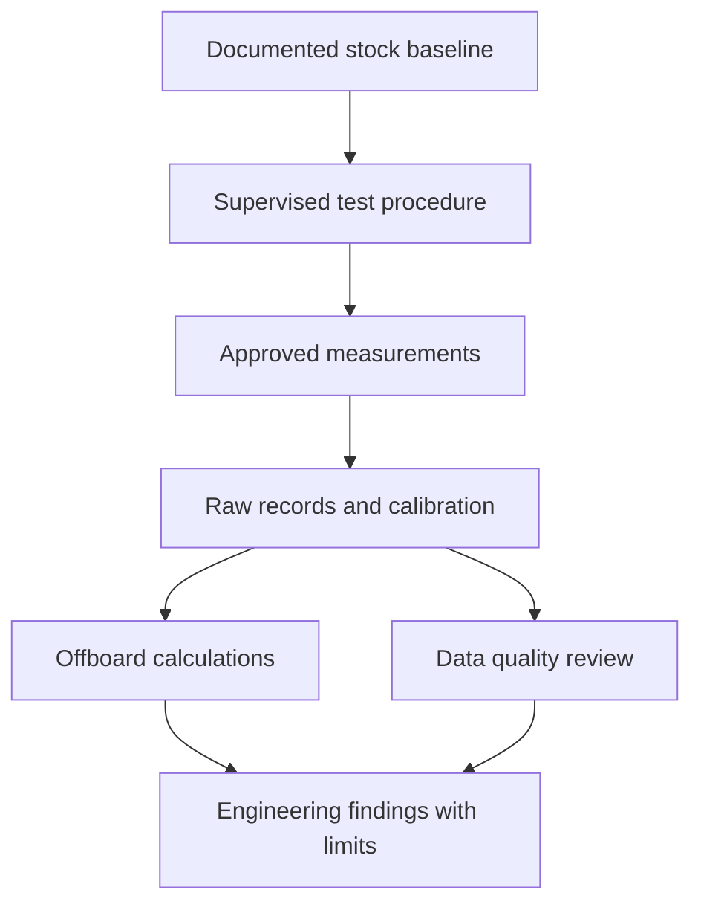

# R15 V2 — Powertrain Engineering

**Asphalt Sovereign | Learning and experimental-planning notebook | 12 November 2026**

## 1. Problem

An engine-development project needs a documented stock baseline, understood measurement channels and repeatable experiments before making calibration or performance claims. This repository organizes that work for the Yamaha R15 V2 research platform.

## 2. Automotive relevance

Powertrain testing connects engine fundamentals, instrumentation, uncertainty and test control. Recording assumptions and unsuccessful or incomplete work is part of making a result reviewable.

## 3. Engineering requirements

Preserve the stock ECU's control role; identify actual vehicle/ECU revision privately; document instrument identity/calibration; separate bench and vehicle evidence; record operating conditions and fuel information only when measured; retain raw files and analysis versions; use a repeatable stock-baseline procedure before comparisons.

## 4. Selected architecture

The research vehicle remains under stock control. Independent read-only acquisition is developed separately in SAN-V1. Offboard calculations and OctaneOS screening consume approved data only after the interface and schema are verified. There is no deployed remap, piggyback controller or active fuel-control system in this repository.

## 5. Method selection

Start with a stock baseline because simultaneous changes to hardware, fuel and calibration would confound comparisons. Use dimensional calculations before interpreting a logger value. Treat a paid course as learning in progress; no course content or certificate is redistributed or implied.

## 6. Implemented

This consolidation provides original study notes, a pulse/timing calculation sheet and an explicitly unexecuted baseline plan. The broader project record reports a purchased research motorcycle and early ESP32 work; it does not supply a completed instrumented powertrain experiment.

## 7. Testing

The worked arithmetic can be independently checked using the formulas in [calculations/pulse-frequency-and-duty.md](calculations/pulse-frequency-and-duty.md). There is no firmware or executable application in this repository. Physical acceptance checks are defined in [experiments/EXP-001-stock-baseline-plan.md](experiments/EXP-001-stock-baseline-plan.md) and remain NOT RUN.

## 8. Actual results

The illustrative pulse-frequency calculation gives 6000 RPM for a hypothetical 100 Hz input at one pulse per revolution. The hypothetical four-stroke cycle at 6000 RPM is 20 ms. These are calculations, not measured R15 values. No power, torque, fuel economy, AFR, emissions or tuning improvement is reported.

## 9. Limitations

The actual diagnostic physical layer, pulse scaling, safe signal-conditioning circuit, sensor calibration and synchronized vehicle dataset remain unverified. A three-pin connector is not assumed to be standard OBD-II. The ECU learning course is in progress. No road-test, dyno, remap or higher-ethanol compatibility evidence is included.

## 10. Next engineering milestone

Complete the documented stock condition record and the separate USB-bench logger gate. Then review a protected interface and execute one supervised stock-fuel acquisition with references, repeatability checks and a dated evidence pack.

## Installation, hardware and dependencies

No installation is required; the repository contains Markdown documents and arithmetic. Any Markdown viewer works. A calculator is sufficient for the examples; there are no pinned software dependencies. For future tests, the actual R15 V2, qualified supervision, approved instruments and separately validated SAN hardware are requirements. No unreviewed vehicle wiring instructions are supplied.

## Evidence assets

There is no measured vehicle dataset or completed-test screenshot to publish yet. The experiment plan uses no invented observations. Results, photographs and raw logs must be added only after the corresponding test is actually performed.

Engineering portfolio: [Asphalt Sovereign](https://github.com/asphaltsovereign/automotive-engineering-portfolio).
